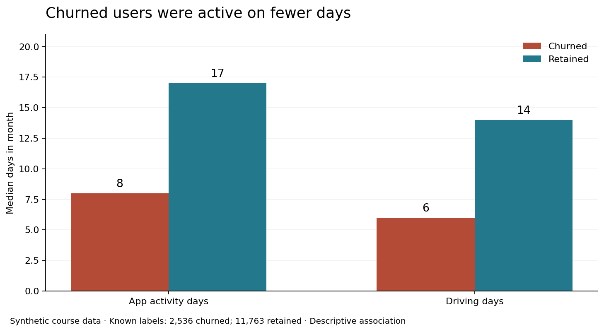

# Waze user churn — Data inspection and preparation

**Hernán Licastro · Python · pandas · Data quality · PACE**

An educational case study preparing synthetic user data for a future monthly churn model. It identifies data quality issues, compares user groups and communicates findings to technical and business stakeholders.

**Main finding:** users labeled as churned were active on fewer days, while device-specific churn rates were similar. Missing labels and inconsistent driving records require investigation before modeling.

## Context and scope

The fictional Waze team wants to identify users at risk of leaving to support future retention initiatives. This milestone imports, inspects and organizes the dataset. No model, formal hypothesis test, causal inference or retention impact is claimed.

The dataset and scenario come from the Google Advanced Data Analytics course project. Data are synthetic and stakeholders fictional. This is not employment at Waze or an analysis of production users.

## Key findings

| Measure | Result | Denominator |
|---|---:|---|
| Users / original columns | 14,999 / 13 | Full dataset |
| Missing labels | 700 (4.67%) | All users |
| Churn / retention | 17.74% / 82.26% | 14,299 known labels |
| Median activity days | 8 churned / 17 retained | Known labels |
| Median tenure | 1,321 / 1,843 days | Churned / retained |
| Android / iPhone churn rate | 17.56% / 17.83% | Known labels within each device |
| Zero driving days with positive km | 1,024 | All users |

No duplicate rows or repeated user IDs were found.

## Method and limitations

PACE guides the work: Plan reviews definitions and scope; Analyze inspects quality and compares groups; Construct is not applicable; Execute communicates findings and next steps.

Raw data are preserved. Missing labels are not imputed or interpreted as churn. The total_sessions variable is a model estimate, not an exact lifetime count. ID is an identifier rather than a behavioral measure. Monthly and lifetime variables must not be treated as covering the same period.

Zero denominators become NaN. Valid median km per driving day are **523.09 churned versus 272.63 retained**. These are medians of individual ratios, not ratios of group medians. Results differ from the course's prewritten commentary because infinite ratios are excluded.

Per-day ratio coverage is **2,143/2,536** churned and **11,173/11,763** retained users. Exclusion rates of **15.50% versus 5.02%** limit comparability and warrant sensitivity analysis. High mileage does not establish occupation. Similar missing-label groups do not prove missingness is completely random.

## Start here

| File | Purpose |
|---|---|
| [English notebook](notebooks/01_data_inspection_en.ipynb) | Concise analysis with executed outputs |
| [Spanish lab](notebooks/02_laboratorio_es.ipynb) | Revised responses and code |
| [PACE strategy](reports/Waze_PACE_ES.docx) | Nine planning questions answered in Spanish |
| [Executive summary](reports/Waze_Resumen_Ejecutivo_ES.pptx) | One-page stakeholder update in Spanish |
| [Data dictionary](data/data_dictionary.csv) | Field meanings and observed types |
| [Analysis script](src/analyze.py) | Rebuild tables, checks and figure |

The reports folder contains CSV evidence and validation metadata. The templates folder retains blank templates and the course proposal for reuse.

## Reproduce

Use Python 3.11 or newer. From the repository root:

    python -m venv .venv

Windows PowerShell activation:

    .\.venv\Scripts\Activate.ps1

macOS/Linux activation:

    source .venv/bin/activate

Then:

    python -m pip install -r requirements.txt
    python src/analyze.py
    jupyter notebook

Open either notebook and run all cells. Both support execution from the project root or notebooks directory.

**Validation:** notebook code cells were executed sequentially in fresh Python namespaces and outputs regenerated; notebook schemas were checked. The analysis script ran against the supplied CSV. This was an in-process execution, not a Jupyter-kernel validation. The validation report records versions and the raw CSV SHA-256. The script rebuilds analytical outputs; Word and PowerPoint are authored deliverables.

## Next steps

Investigate missing labels and inconsistent driving records. Confirm units, sampling, churn definition and observation windows. Prevent temporal leakage before modeling. Later work can perform EDA and hypothesis testing, then evaluate models against a majority-class baseline using churn-sensitive metrics. Longitudinal activity and voluntary feedback could help investigate patterns; retention impact needs separate evaluation.

## Attribution

Sources: supplied Waze proposal, PACE template, executive-summary templates, completed course notebook and waze_dataset.csv. Original course materials retain their respective ownership. This repository presents an educational portfolio adaptation.
